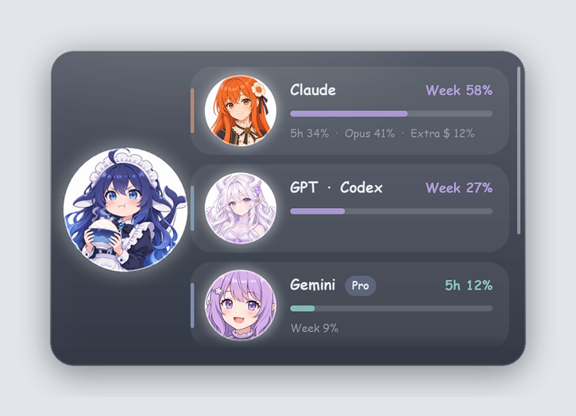
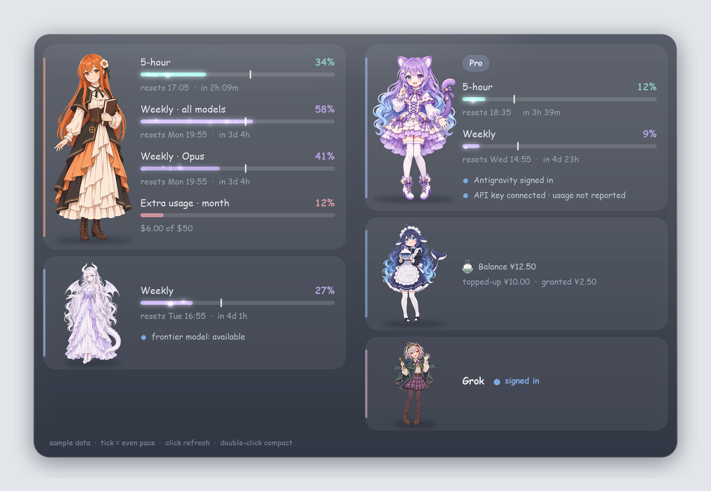
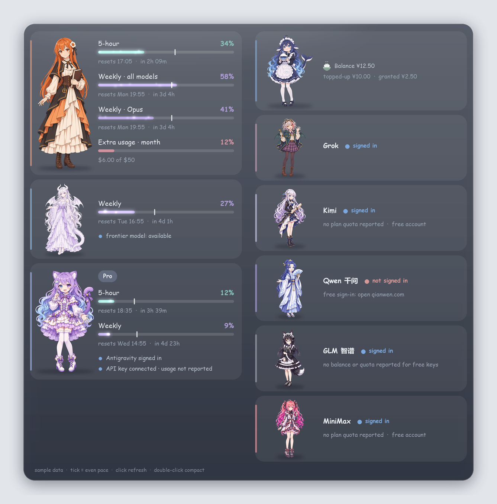

# AI Limits Monitor

A small always-on-top glass panel for Windows that shows how much of your AI subscriptions you have used: **Claude** (Claude Code / claude.ai plan) and **Codex** (ChatGPT plan) usage limits, **Gemini** usage windows from Antigravity, a **DeepSeek** account balance, and sign-in status cards for **Grok, Kimi, Qwen, Doubao, GLM and MiniMax**.

This repository is the **desktop edition** (a floating pane on the Windows desktop). The **T3 edition**, a live page for the right-panel Preview tab of T3 Code, is a separate project: [ai-limits-monitor-t3](https://github.com/P3anutSweet/ai-limits-monitor-t3). Both editions share the same usage readers and mascots.

| Compact | Full |
|---|---|
|  |  |

The screenshots show sample data (`--demo`) on a plain background, not a real account.

> **Unofficial data sources.** Claude and Codex usage is read from the internal endpoints the apps use for their own usage screens: `https://api.anthropic.com/api/oauth/usage` (Claude Code's login) and `https://chatgpt.com/backend-api/wham/usage` (Codex's login). These are **not public APIs**. They are undocumented and can change, be rate-limited or stop working at any time, and the numbers can differ from what the vendor bills. Use them only with your own account and under your provider's terms.

## What it shows

- **Claude:** 5-hour session, weekly (all models), weekly per model when the plan has one, and monthly extra-usage credits.
- **Codex:** weekly limit, plus a 5-hour or per-model limit when the plan has one, and frontier-model availability.
- **Gemini:** Antigravity's own usage windows (5-hour, weekly) as [T3 Code](https://github.com/pingdotgg/t3code) caches them in `~/.t3/caches/antigravity.json`. A window that has reset since the last reading shows as unknown. If `GEMINI_API_KEY` is set, the key is checked with a token-free model listing. A valid key says nothing about usage or billing tier, so the card only says "API key connected · usage not reported". A plan pill or extra lines appear only if you set them (`gemini_badge`, `gemini_notes`).
- **DeepSeek:** account balance (topped-up and granted credit, total spent), read with the DeepSeek Harness sign-in in `~/.dsh/.credentials.yaml`. The balance row uses a rice-bowl icon.
- **Status cards** (sign-in dot plus vendor-reported free quota, never estimated):
  - **Grok:** `~/.grok/auth.json` has a key.
  - **Kimi:** Kimi Code login file plus its usage endpoint while the short-lived token is valid.
  - **Doubao:** `arkcli` (Volcengine).
  - **MiniMax:** `mmx` CLI.
  - **GLM:** a Z.ai key in `ZAI_API_KEY`, checked with a token-free model listing.
  - **Qwen:** browser sign-in, recorded by hand in `<data_dir>\signin_status.json`.
- **Even-pace tick:** a thin tick on each bar marks where usage would be if spread evenly over the window.
- **Alerts:** a Windows notification when a meter passes 80 % and 95 %, once per reset window.
- **In use:** when an AI has written a session transcript in the last 45 s, its bars pulse with rainbow particles and its avatar gets a halo.

Only the services in the `services` setting are shown. The default is Claude, Codex, Gemini, DeepSeek and Grok. Doubao and MiniMax need their vendor CLIs installed through npm.



## Requirements

- Windows 10 or 11.
- Python 3.12 with Tk (the python.org installer), plus Pillow and numpy.
- Signed-in CLIs for the services you enable: Claude Code (`~/.claude/.credentials.json`), Codex (`~/.codex/auth.json`), and optionally T3 Code with Antigravity, DeepSeek Harness, Grok CLI, Kimi Code, `arkcli` or `mmx`.

## Install and run

```powershell
git clone https://github.com/P3anutSweet/ai-limits-monitor.git
cd ai-limits-monitor
py -3.12 -m venv .venv
.venv\Scripts\python.exe -m pip install -r requirements.txt

.venv\Scripts\pythonw.exe ai_limits_monitor_v2.pyw            # the panel
.venv\Scripts\python.exe  ai_limits_monitor_v2.pyw --once     # one reading printed to the console
.venv\Scripts\pythonw.exe ai_limits_monitor_v2.pyw --demo     # sample data, plain background, nothing saved
.venv\Scripts\python.exe  ai_limits_monitor_v2.pyw --demo --snapshot shot.png --full --backdrop   # render one PNG and exit
```

`--snapshot <png>` also takes `--compact` and `--scroll <rows>`. It works while the panel is running. Demo and snapshot runs do not update state or cache files or `latest.json`, and send no alerts. `--snapshot <png>` writes only the PNG you asked for. Without `--demo`, a snapshot still reads your accounts like a normal refresh.

To start the panel at logon, create a shortcut in `shell:startup` to the full path of `.venv\Scripts\pythonw.exe`, with the full path of `ai_limits_monitor_v2.pyw` as its argument.

**Controls:**
- Click: refresh now.
- Drag: move the panel (its position is remembered).
- Double-click: switch between compact and full view.
- Right-click: menu (refresh, open the usage pages, hide, close).
- Compact view: scroll the provider list with the wheel or by dragging inside it.
- Ctrl+Alt+H, or launching it again, shows a hidden panel.

## Settings

All settings are optional. Copy `ai_limits_settings.example.json` to `ai_limits_settings.json` next to the script and edit it. You can also point `AI_LIMITS_SETTINGS` at a settings file elsewhere. Any key can be overridden with an environment variable named `AI_LIMITS_<KEY>`, for example `AI_LIMITS_SERVICES=Claude,Codex` or `AI_LIMITS_TIME_ZONE=0`. Your `ai_limits_settings.json` is in `.gitignore`.

| Key | Default | Meaning |
|---|---|---|
| `data_dir` | `%LOCALAPPDATA%\ai-limits-monitor` | `monitor_state.json` (position, alerts sent) and `latest.json` (token-free snapshot of the last reading) |
| `avatar_dir` | `avatars` next to the script | `<key>_512.png` heads and `<key>_body.png` figures |
| `services` | `Claude, Codex, Gemini, DeepSeek, Grok` | Any of `Claude, Codex, Gemini, DeepSeek, Grok, Kimi, Qwen, Doubao, GLM, MiniMax`, in panel order |
| `time_zone` | `local` | `local`, or a fixed UTC offset in hours (e.g. `8`, `-5`) |
| `time_zone_label` | `""` | Label after times in notes, e.g. `UTC` |
| `background` | `wallpaper` | `wallpaper` = frosted desktop wallpaper behind the glass; `plain` = neutral grey-blue |
| `refresh_minutes` | `5` | How often the panel reads usage |
| `alert_levels` | `[80, 95]` | Notification thresholds in percent; `[]` = none |
| `kimi_credentials` | `%KIMI_CODE_HOME%\credentials\kimi-code.json` | Kimi Code login file |
| `gemini_badge` | `""` | Plan pill on the Gemini card, e.g. `AI Pro` |
| `gemini_notes` | `[]` | Extra info lines on the Gemini card (your own text; not checked) |
| `demo` | `false` | Same as `--demo` |

## Privacy and security

- Login tokens are only **read** from the files the vendor CLIs keep. They are never written, logged, printed or shown. They are sent only to the vendor's own endpoint, in a request header.
- `latest.json` and `monitor_state.json` contain percentages, reset times and balances, never tokens.
- API keys (`GEMINI_API_KEY`, `ZAI_API_KEY`) are read from your environment and only go in request headers.
- The tool collects no telemetry.

## Limits

- Windows only (layered windows, Windows notifications, registry wallpaper lookup).
- The Claude and Codex endpoints are unofficial (see above). When one fails, the panel keeps the last values and shows the error.
- Grok, Qwen and most status cards show sign-in state only, because those vendors report no plan usage for this tool to read.
- The Gemini card depends on T3 Code's cache. Without T3 Code it shows "unknown".
- Fonts: Comic Sans MS for Latin text and Microsoft YaHei UI for Chinese text, as shipped with Windows.

## Characters

The mascots in `avatars/` are **unofficial project illustrations** made with AI image tools for this project. They are not official artwork or characters of any vendor. Their colors and accessories are loose nods to "AI girl" fan traits common in online communities. Any resemblance to a vendor's own mascot, companion or mark is not intended and does not mean an endorsement. If you think an image is too close to someone's mark or character, please open an issue and it will be changed. How each image was made (prompts, tool, input images) is listed in [avatars/README.md](avatars/README.md).

## Not affiliated

This is an independent tool. It is not affiliated with, endorsed by or sponsored by Anthropic, OpenAI, Google, DeepSeek, xAI, Moonshot AI (Kimi), Alibaba (Qwen), ByteDance / Volcengine (Doubao), Zhipu / Z.ai (GLM), MiniMax or T3 Code. All product names are trademarks of their owners.

## License

Code: GPL-3.0, see [LICENSE](LICENSE).

Avatar images (`avatars/`, and the characters in `docs/`): CC BY 4.0, see [avatars/LICENSE](avatars/LICENSE) and [avatars/README.md](avatars/README.md) for attribution and how each image was made.
